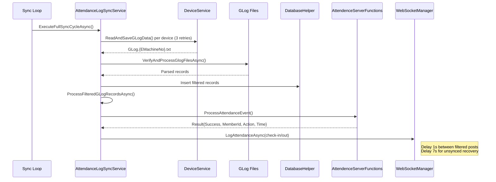
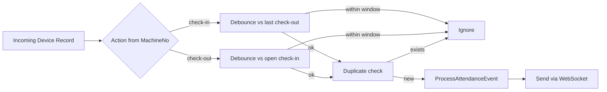
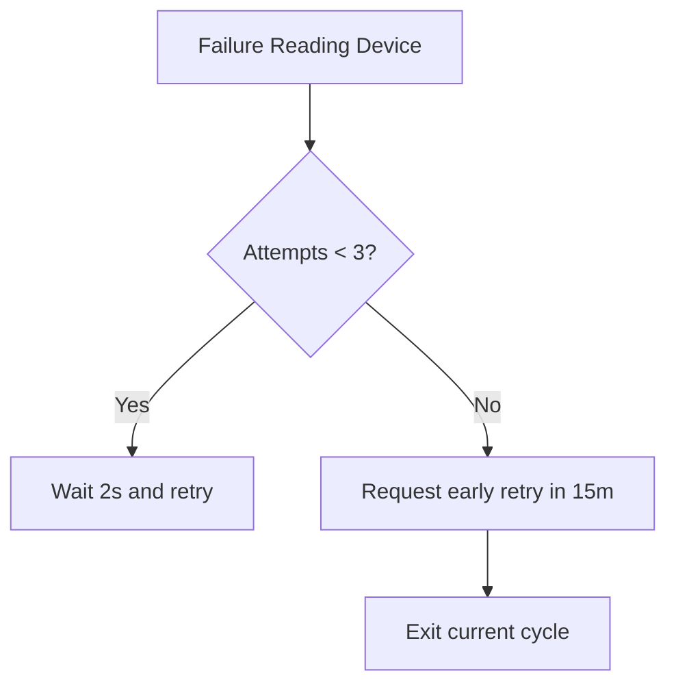

# Smart Attendance MiddlewareX

## Overview

Smart Attendance Middleware is a Windows Forms application (C#, .NET Framework 4.8) that serves as a robust bridge between biometric attendance devices (fingerprint, RFID, face) and a remote attendance server. It manages device communications via OCX controls, schedules background services for synchronization and maintenance, persists data locally (SQLite), and streams events to a server over WebSocket.

Core goals:
- Reliable acquisition of attendance events from multiple devices
- Deterministic processing and de-duplication with debounce rules
- Prioritized syncing to keep check-ins available ahead of check-outs
- Resilient connectivity with retries and backoff

## Key Capabilities

- Multi-device attendance acquisition with retries and prioritization
- Local buffering of device logs (`GLog.{EMachineNo}.txt`) and database persistence
- Debounce window to suppress rapid duplicate events
- Real-time server sync via WebSocket (check-in/check-out)
- Daily maintenance and optional log clearing on devices
- Face enrollment and popup notifications
- User CRUD on devices (rfid/fingerprint/face)
- Device time synchronization and door control

## Application Architecture

### Layers
- UI: `Dashboard` (main), `DeviceManager`, `FacePopupForm`
- Services: `AttendanceLogSyncService`, `LogSyncService`, `PeriodicMaintenanceService`, `EmailBackupService` (if present), lifecycle in `ServiceManager`
- Device/OCX: `DeviceService` (AxFP_CLOCKLib), `ServerThreadInvoker` (AxFPCLOCK_SVRLib), `OcxThreadInvoker` (thread-safe STA invoker)
- Networking: `WebSocketManager` (real-time server link)
- Data: `DatabaseHelper` (SQLite)
- Misc: `Processor`, `AppSession`, `LogHelper`

### OCX Controls
- `AxFP_CLOCKLib.AxFP_CLOCK`: device control for attendance, enrollment, logs
- `AxFPCLOCK_SVRLib.AxFPCLOCK_Svr`: server-side OCX operations when required

### File Outputs
- Attendance dumps: `GLog.{EMachineNo}.txt`
- Staff attendance dumps: `StaffGLogs.{EMachineNo}.txt`
- Face images directory: `FACE/`

## Services, Timers, and Schedules

The middleware uses several background services. Their responsibilities, timers, and special behaviors are summarized below.

- `AttendanceLogSyncService`
  - Start: immediately at app launch via `ServiceManager.StartAttendanceLogSyncService`
  - Initial cycle: runs immediately, raises `InitialSyncCompleted` event once
  - Regular interval: 6 hours (360 minutes)
  - Early global retry: 15 minutes if prioritized device sync fails
  - Unexpected error delay: 30 seconds before retrying loop
  - Device-level retries: up to 3 attempts per device, 2 seconds between attempts
  - Inter-record server delay: 7 seconds between check-in/check-out posts (unsynced recovery); 1 second after each processed filtered record
  - Continuous loop toggle: `_continuousSyncEnabled` (false disables further cycles after initial)

- `PeriodicMaintenanceService`
  - Start delay: 15 minutes after app start
  - Interval: every 30 minutes
  - Special: clears device general logs once per 24 hours (conditioned and tracked via settings)

- `LogSyncService`
  - Trigger: on-demand from `DeviceFunctions`/dashboard actions
  - Purpose: short-lived coordination during device-driven operations

- `EmailBackupService` (if present)
  - Schedule: daily at configured time
  - Function: snapshot SQLite DB and email

- `WebSocketManager`
  - Connection: on app start
  - Behavior: continuous with auto-reconnect, used for member updates and attendance posting

- `FacePopupForm`
  - Display duration: default 3 seconds per popup (`DEFAULT_DISPLAY_SECONDS`)

### Lifecycle Control
`ServiceManager` centralizes start/stop:
- `StartLogSyncService(DeviceFunctions deviceFunctions)`: starts `LogSyncService`
- `StopLogSyncService()`: stops and nulls
- `StartAttendanceLogSyncService(WebSocketManager wsManager)`: starts and wires sync service
- `StopAttendanceLogSyncService()`: stops, disposes, clears
- `StartPeriodicMaintenanceService(Dashboard dashboard)`: starts periodic maintenance, logs success
- `StopPeriodicMaintenanceService()`: stops, disposes, logs stop
- `StopAllServices()`: stops all and logs

## Timers and Intervals Reference

- `AttendanceLogSyncService`
  - `_syncInterval`: 21,600,000 ms (6 hours)
  - `_earlyRetryInterval`: 900,000 ms (15 minutes)
  - `_retryDelay`: 30,000 ms (30 seconds)
  - Per-device retries: 3 attempts with 2,000 ms between attempts
  - Server posting delay: 7,000 ms between unsynced log posts; 1,000 ms after filtered event post

- `PeriodicMaintenanceService`
  - Initial delay: 900,000 ms (15 minutes)
  - Interval: 1,800,000 ms (30 minutes)
  - Log clear cadence: once every 24 hours

- UI/UX
  - `FacePopupForm` display: 3,000 ms default

## Detailed Data and Process Flow

### Startup
1. `Dashboard` initializes UI and loads configuration from `DatabaseHelper`
2. `WebSocketManager` connects to server
3. `ServiceManager.StartAttendanceLogSyncService(ws)` ? immediate initial sync
4. `ServiceManager.StartPeriodicMaintenanceService(dashboard)` ? delayed 15 min start
5. Devices discovered from DB; `AppSession.DeviceList` populated

### Attendance Acquisition and Processing
1. `AttendanceLogSyncService.ExecuteFullSyncCycleAsync`
   - `SyncAllDeviceLogsAsync` prioritizes devices:
     - `check-in` devices ? `check-out` devices ? other
     - `DownloadDeviceLogsWithRetry` per device: up to 3 attempts, 2s delay
     - Reads logs using `DeviceService.ReadAndSaveGLogData` (generates `GLog.{EMachineNo}.txt`)
     - On failure, sets `_earlyRetryRequested = true` ? next loop in 15 min
   - `VerifyAndProcessGlogFilesAsync` parses all `GLog.*.txt` files
     - Skips invalid or EnrollNo `00000000000`
     - Inserts records into DB with original line payload
     - Deletes processed files
   - `ProcessFilteredGLogRecordsAsync`
     - Gets filtered records via `DatabaseHelper.FilterAndUpdateGLogRecordsByDateTwoWay`
     - Maps `DeviceId ? machineNo ? action (check-in/check-out)`
     - Debounce window from setting `AttendanceDebounceSeconds`
       - Blocks check-out if within debounce secs of open check-in
       - Blocks check-in if within debounce secs of last check-out
     - Duplicate prevention via `RecordExistsInAttendanceLogAsync`
     - Calls `AttendenceServerFunctions.ProcessAttendanceEvent`
     - Sends to server via `WebSocketManager.LogAttendanceAsync` with 7s spacing (and 1s after filtered posts)
2. `SyncUnsyncedAttendanceLogsAsync` can push pending logs on demand

### Maintenance
- Every 30 minutes:
  - Update dashboard labels
  - Check and optionally clear device general logs once per day
  - Track timestamps in settings

### Shutdown
- `ServiceManager.StopAllServices()` ensures orderly stop/dispose and logs

## Workflows (Diagrams)

```mermaid
flowchart TD
    A[App Start] --> B[Dashboard loads settings]
    B --> C[WebSocketManager connects]
    B --> D[Start AttendanceLogSyncService]
    B --> E[Start PeriodicMaintenanceService (after 15m)]
    D --> F[Initial Sync Cycle]
    F --> G{_continuousSyncEnabled?}
    G -- false --> H[Stop after initial]
    G -- true --> I[Wait _syncInterval (6h) or 15m early retry]
    I --> F
```







## Device Operations (DeviceService)

Thread-safe OCX operations via `OcxThreadInvoker.Run(ip, ocx => ...)`. Key methods:
- Identification
  - `GetSerial(ip, port, machineNo, password)` ? device serial number
- Enrollment
  - `AddFace(ip, port, machineNo, password, enrollNumber, imageFilePath)`
  - `AddRfidCard(ip, port, machineNo, password, enrollmentNumber, cardNumber, enrollmentMachineId = 1)`
  - `AddFingerprint(ip, port, machineNo, password, enrollmentNumber, fingerNumber, privilege, templateData)`
- User Data
  - `SetUserName(ip, port, machineNo, password, enrollmentNumber, userName, enrollmentMachineId = 0)`
  - `GetUserName(ip, port, machineNo, password, enrollmentNumber, enrollmentMachineId = 0)`
  - `GetUserInfo(ip, port, machineNo, password, aliasId)` ? returns rich `UserInfo`
- User Control
  - `EnableUser(...)` / `DisableUser(...)` via `SetUserEnabledStatus(...)`
  - `DeleteEnrollmentData(ip, port, machineNo, password, enrollmentNumber, enrollmentMachineId, backupNumber)`
  - `DeleteUserControl(ip, port, machineNo, password, enrollmentNumber)`
- Logs
  - `ReadAndSaveGLogData(ip, port, machineNo, password)` ? writes `GLog.{EMachineNo}.txt`
  - `ReadAndSaveStaffGLogData(ip, port, machineNo, password)` ? writes `StaffGLogs.{EMachineNo}.txt`
  - `EmptyGeneralLogData(ip, port, machineNo, password)`
  - `EmptyEnrollmentData(ip, port, machineNo, password)`
- Device Control
  - `SetDeviceTime(ip, port, machineNo, password)`
  - `OpenDoor(ip, port, machineNo, password)`

Safety patterns:
- Disable device before sensitive ops, re-enable in `finally`
- Close comm port in `finally`
- Marshal unmanaged memory for photo enrollment
- Normalize RFID card number (unsigned 32-bit handling)
- Extensive logging with contextual details

## UI Components

- `Dashboard`:
  - Service status indicators and controls
  - Member and device summaries
  - Initiates start/stop for services via `ServiceManager`
- `DeviceManager`:
  - Configure devices (IP, port, machine number, password, action mapping)
  - Set `AttendanceDebounceSeconds` and other settings
  - Test connections and perform device ops
- `FacePopupForm`:
  - Bottom-right popup showing action, enrollment ID, event time
  - Default display duration: 3 seconds (`DEFAULT_DISPLAY_SECONDS`)
  - Loads image from `FACE/{memberId|enrollmentId}.{jpg|png}` or shows fallback

## Database Schema (SQLite)

Tables and typical fields (exact names may vary):
- `Settings`
  - keys: `AttendanceDebounceSeconds`, last-clear timestamps, API keys
- `Members`
  - `MemberID`, `Name`, `Status`, `RFID`, `Picture`, `EnrollmentID`
- `AttendanceLogs`
  - `LogID`, `MemberID`, `CheckInTime`, `CheckOutTime`, sync flags
- `Devices`
  - `DeviceID`, `DeviceIP`, `Port`, `MachineNo`, `Password`, `Action`
- `LocalUsers`
  - `UserName`, `Role`, `PasswordHash`, `BackupCode`

Important mappings:
- Device `MachineNo ? Action (check-in/check-out)` used by processing and debounce
- Enrollment `EnrollmentNumber ? MemberID`

## Configuration

- Device configuration via `DeviceManager`
- Server endpoints and WebSocket URL in settings
- Email settings (if using `EmailBackupService`)
- Debounce seconds in `Settings.AttendanceDebounceSeconds`

## Dependencies

- OCX: `AxFP_CLOCKLib`, `AxFPCLOCK_SVRLib`
- Database: `System.Data.SQLite`
- Networking: WebSocket client
- JSON: `Newtonsoft.Json` (typical usage)

## Error Handling and Resilience

- Device-level retries with counters and delays
- Early global retry on prioritized sync failure
- Duplicate detection before inserting attendance
- Debounce window prevents noisy duplicates
- Auto-reconnect for WebSocket
- Try/catch with contextual logs in all I/O paths

## Logging

- Human-friendly logs with emojis for clarity
- Service lifecycle: start/stop
- Device ops, failures with details
- Sync summaries (success/failure counts)
- Maintenance actions and outcomes

## Security Notes

- Device credentials stored securely
- Local DB with optional encryption
- Password hashing for local users
- Controlled file access for face images and backups

## Versioning and Assembly

- Assembly info: `Properties/AssemblyInfo.cs`
  - `AssemblyTitle`: smart-attendance-middleware
  - `Company`: HP
  - Version: `1.0.0.0`

## Operational Playbook

- Start app ? services initialize (sync immediate, maintenance delayed)
- Keep devices online and reachable (IP/Port/MachineNo)
- Ensure `AttendanceDebounceSeconds` configured
- Monitor dashboard and logs for sync status
- Use `DeviceManager` for enrollment and device ops
- Rely on WebSocket for continuous server updates
- Perform daily backups (if enabled)

## Troubleshooting

- Connection failures: verify IP/Port/password; OCX registration
- No GLog files: check `DeviceService.ReadAndSaveGLogData` results and permissions
- Debounce blocks expected events: adjust `AttendanceDebounceSeconds`
- Repeated failures: inspect logs, device retries, and early retry behavior
- WebSocket issues: endpoint correctness and network stability

## License

[Specify your license here]

## Support

Provide logs and environment details (device IPs, machine numbers, settings) when reporting issues.
